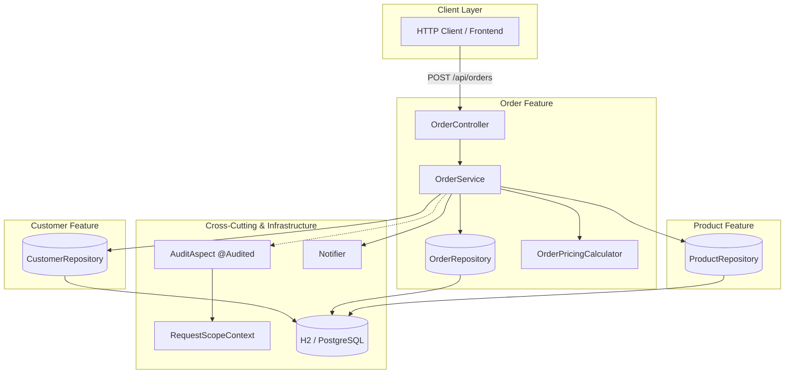
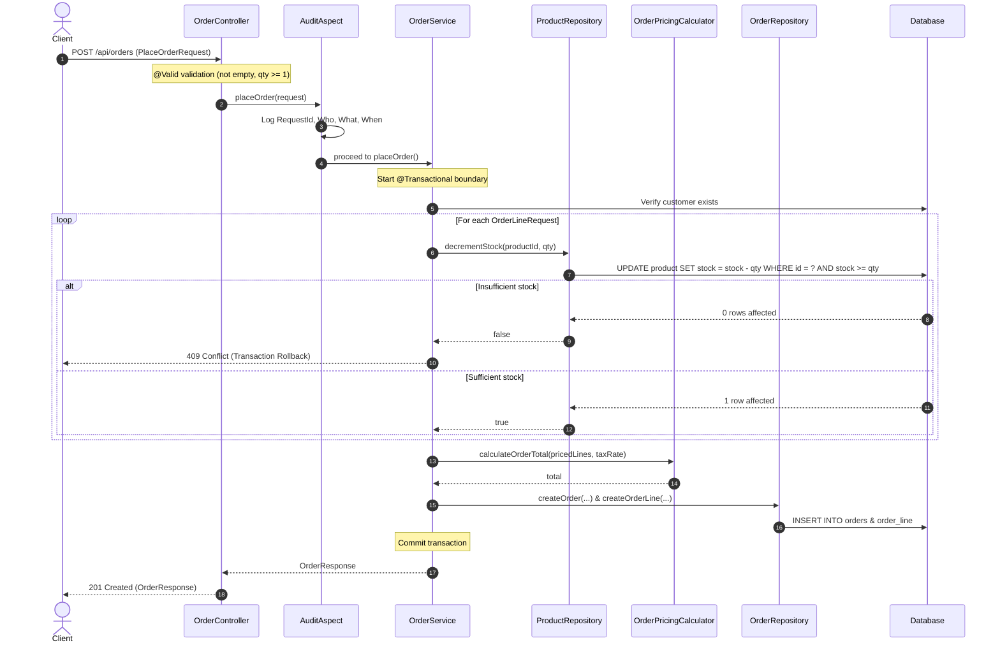

# I4-SE-G2

## Bootstrapping with Maven and Spring Boot

### What does the `<parent>` give you?

`spring-boot-starter-parent` 4.1.1 sets the dependency versions and the build defaults (Java 25, compiler, tests, and the jar plugin). This project does not pick those versions itself.

### Why do the starters have no `<version>`?

The parent manages them. Maven fills in the version from the parent's `dependencyManagement`. Every starter below resolved to `4.1.1`.

### What does `spring-boot-maven-plugin` do at package time?

`package` first builds a thin jar of this project's classes. The plugin then repackages it into an executable jar. `java -jar` starts `JarLauncher`, which loads `BOOT-INF/lib` and `BOOT-INF/classes` and runs `edu.itc.shop.ShopApplication`.

### Dependency tree (first level)

```text
edu.itc.se:shop:jar:0.0.1-SNAPSHOT
+- org.springframework.boot:spring-boot-h2console:jar:4.1.1:compile
+- org.springframework.boot:spring-boot-starter-actuator:jar:4.1.1:compile
+- org.springframework.boot:spring-boot-starter-jdbc:jar:4.1.1:compile
+- org.springframework.boot:spring-boot-starter-validation:jar:4.1.1:compile
+- org.springframework.boot:spring-boot-starter-webmvc:jar:4.1.1:compile
+- org.springframework.boot:spring-boot-starter-aspectj:jar:4.1.1:compile
+- org.springframework.boot:spring-boot-devtools:jar:4.1.1:runtime (optional)
+- com.h2database:h2:jar:2.4.240:runtime
+- org.springframework.boot:spring-boot-starter-actuator-test:jar:4.1.1:test
+- org.springframework.boot:spring-boot-starter-jdbc-test:jar:4.1.1:test
+- org.springframework.boot:spring-boot-starter-validation-test:jar:4.1.1:test
\- org.springframework.boot:spring-boot-starter-webmvc-test:jar:4.1.1:test
```

### Jar size

`target/shop-0.0.1-SNAPSHOT.jar` is 29,980,119 bytes (about 29 MB). The thin jar, `shop-0.0.1-SNAPSHOT.jar.original`, is 5,352 bytes.

The executable jar is large because Tomcat, Spring, H2, and the other starters are copied into `BOOT-INF/lib`. The `.original` file is only this project's classes.

### Actuator health

`GET /actuator/health` returned HTTP 200:

```json
{"groups":["liveness","readiness"],"status":"UP"}
```

With `--debug`, `DataSourceAutoConfiguration` matched because the JDBC classes are on the classpath (`spring-boot-starter-jdbc` and H2):

```text
DataSourceAutoConfiguration matched:
   - @ConditionalOnClass found required classes 'javax.sql.DataSource', 'org.springframework.jdbc.datasource.embedded.EmbeddedDatabaseType' (OnClassCondition)
   - @ConditionalOnMissingBean (types: io.r2dbc.spi.ConnectionFactory; SearchStrategy: all) did not find any beans (OnBeanCondition)
```

Startup then connected Hikari to `jdbc:h2:mem:...`.

## Inversion of control, dependency injection and bean lifecycle

### Constructor Injection & AppConfig

All beans use constructor injection with `final` fields. No field injection (`@Autowired` on fields) is used anywhere, which guarantees immutability, prevents partially initialized objects, and enables straightforward unit testing without Spring.

`Clock` is provided via an `@Bean` method in `config/AppConfig`:

```java
@Configuration
public class AppConfig {
    @Bean
    public Clock clock() {
        return Clock.systemDefaultZone();
    }
}
```

`WelcomeService` injects two `Notifier` implementations and the `Clock` through its constructor:

```java
@Service
public class WelcomeService {
    private final Notifier defaultNotifier;
    private final Notifier urgentNotifier;
    private final Clock clock;

    public WelcomeService(Notifier defaultNotifier, @Qualifier("smsNotifier") Notifier urgentNotifier, Clock clock) {
        this.defaultNotifier = defaultNotifier;
        this.urgentNotifier = urgentNotifier;
        this.clock = clock;
    }
    ...
}
```

### Disambiguation: `@Primary` vs `@Qualifier`

When multiple beans implement the `Notifier` interface (`EmailNotifier`, `SmsNotifier`, `ConsoleNotifier`):
- `Notifier defaultNotifier`: Because no qualifier is specified, Spring resolves by type and selects `EmailNotifier` because it is marked `@Primary`.
- `@Qualifier("smsNotifier") Notifier urgentNotifier`: The qualifier explicitly directs Spring to inject the bean named `smsNotifier`.

In `welcome(String user, boolean urgent)`, `WelcomeService` selects `urgentNotifier` when `urgent` is true, and `defaultNotifier` otherwise.

### Lifecycle Callbacks & Prototype Scope

- **Lifecycle Callbacks**: `EmailNotifier`, `SmsNotifier`, and `ConsoleNotifier` declare `@PostConstruct` (`init()`) and `@PreDestroy` (`destroy()`) methods. On application startup, `EmailNotifier ready` and `SmsNotifier ready` are logged. On context shutdown (e.g. on Ctrl+C or when stopping the context), `EmailNotifier closing` and `SmsNotifier closing` are logged.
- **Prototype Scope**: `ReportBuilder` is annotated with `@Scope("prototype")`. In `ShopApplication`, an `ObjectProvider<ReportBuilder>` is injected. Calling `getObject()` twice produces two distinct object instances with different identity hash codes:

```text
INFO edu.itc.shop.ShopApplication : prototype instances differ: true
```

### Active Profile and the Rule for Multiple `@Primary` Beans

A third implementation `ConsoleNotifier` is annotated with `@Profile("dev")` and `@Primary`.

1. **Default profile (without `dev`)**:
   Only `EmailNotifier` and `SmsNotifier` are registered in the ApplicationContext. `EmailNotifier` is marked `@Primary`, so it is injected into `WelcomeService`. Startup prints:

   ```text
   INFO edu.itc.shop.ShopApplication : 323 beans; notifiers = [emailNotifier, smsNotifier]
   INFO edu.itc.shop.service.EmailNotifier : EMAIL to=ann text=Welcome ann! It is 14:01:06
   INFO edu.itc.shop.service.SmsNotifier : SMS to=bob text=Welcome bob! It is 14:01:06
   ```

2. **What happens if both `@Primary` beans are active simultaneously?**
   If `EmailNotifier` has `@Primary` (without profile filter) and `ConsoleNotifier` is active with `@Profile("dev")` and `@Primary`, Spring encounters **two** primary beans for the `Notifier` dependency.
   
   Spring fails at startup with:

   ```text
   org.springframework.beans.factory.NoUniqueBeanDefinitionException: No qualifying bean of type 'edu.itc.shop.service.Notifier' available: more than one 'primary' bean found among candidates: [consoleNotifier, emailNotifier, smsNotifier]
       at org.springframework.beans.factory.support.DefaultListableBeanFactory.determinePrimaryCandidate(DefaultListableBeanFactory.java:2105)
   ```

   **The rule in Spring**:
   Spring requires that at most **one** candidate bean of a given type may be marked `@Primary`. If multiple matching beans in the same ApplicationContext are marked `@Primary`, Spring does not guess, does not prioritize one profile over un-profiled beans, and does not use bean order. Instead, `determinePrimaryCandidate` throws a `NoUniqueBeanDefinitionException`.

3. **Demonstrating profile switching**:
   To cleanly switch implementations between profiles, `EmailNotifier` is marked `@Profile("!dev")` and `ConsoleNotifier` is marked `@Profile("dev")`. When running with `--spring.profiles.active=dev`, only `ConsoleNotifier` is active as `@Primary`, and `ConsoleNotifier` is used:

   ```text
   INFO edu.itc.shop.ShopApplication : 323 beans; notifiers = [consoleNotifier, smsNotifier]
   INFO edu.itc.shop.service.ConsoleNotifier : CONSOLE to=ann text=Welcome ann! It is 14:00:05
   INFO edu.itc.shop.service.SmsNotifier : SMS to=bob text=Welcome bob! It is 14:00:05
   ```

### Plain Unit Testing: `WelcomeServiceTest`

`WelcomeServiceTest` tests `WelcomeService` without starting a Spring ApplicationContext (no `@SpringBootTest`, no `@ExtendWith(SpringExtension.class)`):
- Dependencies (`Notifier` and `Clock`) are passed directly via the constructor.
- A `FakeNotifier` test double records calls (`to` and `text`).
- `Clock.fixed(Instant.parse("2026-09-25T09:15:02Z"), ZoneId.of("UTC"))` provides a predictable, fixed timestamp.
- The test verifies:
  - Non-urgent welcome calls the default notifier and formats the message correctly.
  - Urgent welcome calls the urgent notifier.
  - Tests run in milliseconds without Spring overhead.

## JDBC, JdbcClient and transactions

### Schema and data

`schema.sql` creates the `product` table (identity PK, `name VARCHAR(80) NOT NULL UNIQUE`, `price DECIMAL(10,2)`, `stock INT CHECK (stock >= 0)`). `data.sql` inserts five products. H2 runs in memory, so Spring Boot runs both scripts at startup without `spring.sql.init.mode`.

The H2 console at `/h2-console` is enabled only in the `dev` profile (see Task 5). Outside `dev` no fixed URL is set, so Boot gives each application context its own in-memory database (`jdbc:h2:mem:<uuid>`). Tests that start different contexts then do not share a database, and `schema.sql` does not run twice against the same one. With `dev`, the URL is fixed to `jdbc:h2:mem:shop` (user `sa`, empty password).

### Raw JDBC vs JdbcClient

| | `RawJdbcProductRepository.findAll()` | `ProductRepository.findAll()` |
|---|---|---|
| Lines in the method | 18 | 5 |
| Opens/closes connection, statement, result set | by hand (try-with-resources) | `JdbcClient` |
| Maps a row to `Product` | by hand, column by column | automatic (record components match column names) |
| `SQLException` | checked, wrapped by hand | translated to `DataAccessException` |

The raw version needs 18 lines for one query. Most of them are resource handling and mapping code that would be repeated in every method. `JdbcClient` handles the resources, the row mapping and the exceptions.

All SQL uses bound parameters (`:id`, `:delta`, `:pattern`, …). User input is never concatenated into the SQL string. For `findByNameContaining`, the `%` wildcards are added to the parameter value, not to the SQL.

### Transaction: `ProductService.restock`

`restock(fromId, toId, qty)` is `@Transactional`. It runs two `UPDATE`s on one connection with `autoCommit=false`:

1. `stock - qty` on `fromId`. The `WHERE ... AND stock + :delta >= 0` guard makes it affect 0 rows when there is not enough stock, and the method then throws `IllegalStateException`.
2. `stock + qty` on `toId`. If that product does not exist, it affects 0 rows and the method throws `IllegalStateException`.

`IllegalStateException` is a `RuntimeException`, so the transaction proxy rolls back. `ProductServiceTest` (`@SpringBootTest`) proves this:

- `restockRollsBackWhenSourceHasTooLittleStock`: qty 1000 fails, and both stocks are unchanged.
- `restockRollsBackFirstUpdateWhenTargetDoesNotExist`: the first `UPDATE` succeeds, the second hits a missing product, and the first update is undone. This is the test that actually needs the rollback.
- `restockMovesStockWhenEnoughUnits`: the happy path.

The test turns on DEBUG logging for `org.springframework.jdbc` and `org.springframework.transaction`. The output shows the rollback:

```text
DEBUG o.s.jdbc.support.JdbcTransactionManager : Creating new transaction with name [edu.itc.shop.service.ProductService.restock]: PROPAGATION_REQUIRED,ISOLATION_DEFAULT
DEBUG o.s.jdbc.core.JdbcTemplate              : Executing prepared SQL statement [UPDATE product SET stock = stock + ? WHERE id = ? AND stock + ? >= 0]
DEBUG o.s.jdbc.support.JdbcTransactionManager : Initiating transaction rollback
DEBUG o.s.jdbc.support.JdbcTransactionManager : Rolling back JDBC transaction on Connection [HikariProxyConnection@1648668612 wrapping conn0: url=jdbc:h2:mem:<uuid> user=SA]
```

(Boot 4 configures `JdbcTransactionManager`, a subclass of `DataSourceTransactionManager`.)

`restock` must be called from outside `ProductService`. A call from another method of the same class would skip the proxy and run without a transaction.

`ProductRepositoryTest` (`@JdbcTest` + `@Import`) tests the repository on its own: find all/by id/by name, insert with a generated id, the negative-stock guard, delete, a check that the raw and `JdbcClient` versions return the same rows, and the duplicate-name case below.

```text
$ ./mvnw -q test
Tests run: 8  -- ProductRepositoryTest
Tests run: 3  -- ProductServiceTest
Tests run: 1  -- ShopApplicationTests
```

### Duplicate name: which exception and where it is translated

Inserting a second product named `Keyboard` throws **`org.springframework.dao.DuplicateKeyException`** (a `DataAccessException`). Its cause is H2's `JdbcSQLIntegrityConstraintViolationException`.

The stack trace shows where the translation happens:

```text
org.springframework.dao.DuplicateKeyException <- cause org.h2.jdbc.JdbcSQLIntegrityConstraintViolationException
  at o.s.jdbc.support.SQLExceptionSubclassTranslator.doTranslate
  at o.s.jdbc.support.AbstractFallbackSQLExceptionTranslator.translate
  at o.s.jdbc.core.JdbcTemplate.translateException
  at o.s.jdbc.core.JdbcTemplate.update
  at o.s.jdbc.core.simple.DefaultJdbcClient$DefaultStatementSpec.update
  at edu.itc.shop.repository.ProductRepository.insert
  at o.s.dao.support.PersistenceExceptionTranslationInterceptor.invoke
  at edu.itc.shop.repository.ProductRepository$$SpringCGLIB$$0.insert
```

- `JdbcClient` delegates to `JdbcTemplate`. `JdbcTemplate` catches the `SQLException` and passes it to its `SQLExceptionTranslator`, which maps the SQL state to `DuplicateKeyException`. So the translation happens inside the JDBC template, before the exception leaves `insert()`.
- `@Repository` also wraps the bean in a proxy (`ProductRepository$$SpringCGLIB$$0`) with `PersistenceExceptionTranslationInterceptor`. That proxy translates any native persistence exception that is not yet a `DataAccessException` (for example from JPA or plain JDBC code). Here the exception is already a `DataAccessException`, so the proxy lets it through unchanged.

Because of this, callers only see Spring's database-independent `DataAccessException` hierarchy and never H2-specific classes.

## JSP views, profiles, Actuator, logging and an aspect

### JSP pages

The packaging is now `war`. `tomcat-embed-jasper` (scope `provided`) compiles the JSPs. `jakarta.servlet.jsp.jstl` supplies the JSTL tags. Views resolve to `/WEB-INF/jsp/<name>.jsp` (`spring.mvc.view.prefix`/`suffix`).

`ProductPageController` (`@Controller`, `/products`):

| Request | What happens |
|---|---|
| `GET /products?q=` | `products/list.jsp`: the search box and a table with net price, gross price (`price × (1 + taxRate)`) and stock. Rows below the low-stock threshold are highlighted. |
| `GET /products/new` | `products/form.jsp`, an empty `CreateProduct` form |
| `POST /products` | `@Valid @ModelAttribute` + `BindingResult`. On errors, the form is shown again with `<form:errors>` per field. On success, a **redirect** to `/products` with a flash message (POST-redirect-GET). |

All user data is written with `<c:out>` or the Spring form tags, which escape HTML. A product named `USB-C <cable>` renders as `USB-C &lt;cable&gt;`. A duplicate name is reported as a form error on `name` (`ProductService.nameExists`), not as an error page. The page controller has no try/catch. `ApiExceptionHandler` is limited to `@RestController`s, so the JSON error format applies only to the API.

> **Note:** run JSPs with `./mvnw spring-boot:run` or from the IDE. `java -jar target/shop-0.0.1-SNAPSHOT.war` cannot find the JSTL TLDs when the project path contains a space (here `Software Engineering`). Tomcat's jar scanner encodes the space twice (`%2520`) and cannot open the war. Copying the war to a path without spaces works.

### Profiles and typed properties

| | default (tests) | `dev` | `prod` |
|---|---|---|---|
| Datasource | random `jdbc:h2:mem:<uuid>` | `jdbc:h2:mem:shop` | `${DB_URL}`, `${DB_USERNAME}`, `${DB_PASSWORD}` from the environment |
| H2 console | off | **on** at `/h2-console` | **off** |
| Logging | INFO | DEBUG for `edu.itc.shop` and `org.springframework.jdbc.core` (SQL) | INFO |

No password is committed. `prod` only reads environment variables, and without `DB_URL` the app does not start (`'url' must start with "jdbc"`).

`config/ShopProperties` is a `@Validated @ConfigurationProperties("shop")` record, found by `@ConfigurationPropertiesScan`:

```yaml
shop:
  currency: USD            # @NotBlank, 3 letters
  tax-rate: 0.10           # @NotNull, 0.00 – 1.00
  low-stock-threshold: 5   # @PositiveOrZero
```

An invalid value (for example `shop.tax-rate=1.5`) stops the application at startup. `ShopPropertiesValidationTest` proves this. `PricingService` uses the tax rate for the gross price.

Startup, `dev`:

```text
$ ./mvnw spring-boot:run -Dspring-boot.run.profiles=dev
13:37:09.563 INFO  [main] edu.itc.shop.ShopApplication             : The following 1 profile is active: "dev"
13:37:10.422 INFO  [main] o.s.b.h.a.H2ConsoleAutoConfiguration     : H2 console available at '/h2-console'. Database available at 'jdbc:h2:mem:shop'
13:37:10.485 INFO  [main] edu.itc.shop.ShopApplication             : Started ShopApplication in 1.056 seconds
```

Startup, `prod` (H2 used as the "external" DB for the demo):

```text
$ DB_URL=jdbc:h2:mem:prod DB_USERNAME=sa java -jar shop.war --spring.profiles.active=prod
13:37:36.533 INFO  [main] edu.itc.shop.ShopApplication             : The following 1 profile is active: "prod"
13:37:38.199 INFO  [main] edu.itc.shop.ShopApplication             : Started ShopApplication in 1.864 seconds
$ curl -o /dev/null -w '%{http_code}' localhost:8080/h2-console
404
```

`prod` has no `H2 console available` line, and the console URL returns 404.

### Actuator

Exposed endpoints: `health,info,metrics,loggers`. Health shows details.

`health/LowStockHealthIndicator` (component name `lowStock`) is DOWN when any product has fewer than `shop.low-stock-threshold` units. The seed data has `Keyboard` with 3 units, so health is DOWN (HTTP 503):

```text
$ curl localhost:8080/actuator/health
{"components":{"db":{"status":"UP",...},"lowStock":{"details":{"threshold":5,"lowStockProducts":["Keyboard"]},"status":"DOWN"},"ping":{"status":"UP"},...},"status":"DOWN"}
```

`info.app.*` is filled from Maven properties (`@project.version@` etc., replaced by resource filtering). The `build-info` goal adds `build.*`:

```text
$ curl localhost:8080/actuator/info
{"app":{"name":"shop","description":"Lab-02 shop application","version":"0.0.1-SNAPSHOT","java":"25.0.4.1","spring-boot":"4.1.1"},
 "build":{"artifact":"shop","name":"shop","time":"2026-10-27T06:37:08.182Z","version":"0.0.1-SNAPSHOT","group":"edu.itc.se"}}
```

### Logging with a request id

`web/RequestIdFilter` (a `OncePerRequestFilter` with the highest precedence) puts an 8-character random `requestId` into the MDC. It also returns the id as the `X-Request-Id` header. It removes the id in `finally`, because Tomcat reuses the thread for the next request. The console pattern prints `[%X{requestId}]`; lines outside a request show `[main]`.

Each product creation is logged at INFO in `ProductService.create`. Each failed validation is logged at WARN, in `ApiExceptionHandler` (REST) and `ProductPageController` (form):

```text
13:37:25.773 INFO  [33e58778] edu.itc.shop.service.ProductService      : created product 7 'HDMI cable'
13:37:25.773 DEBUG [33e58778] edu.itc.shop.service.TimingAspect        : ProductService.create(..) took 713 µs
13:37:25.785 WARN  [609286ac] edu.itc.shop.web.ApiExceptionHandler     : Validation failed for uri=/api/products: [{message=must be greater than or equal to 0, field=stock}, {message=must not be blank, field=name}, {message=must be greater than or equal to 0.01, field=price}]
```

### Timing aspect and runtime log level

`service/TimingAspect` is an `@Around` advice on `@within(org.springframework.stereotype.Service) && execution(public * *(..))`, so it covers every public method of every `@Service`. It logs `<method> took <µs>` at DEBUG, which is on in `dev`.

The logger level can be changed while the app runs:

```text
$ curl localhost:8080/actuator/loggers/edu.itc.shop.service.TimingAspect
{"effectiveLevel":"DEBUG"}

$ curl -X POST localhost:8080/actuator/loggers/edu.itc.shop.service.TimingAspect \
       -H 'Content-Type: application/json' -d '{"configuredLevel":"OFF"}'
HTTP 204   → further requests log no "took … µs" lines (no restart)

$ curl -X POST ... -d '{"configuredLevel":"DEBUG"}'
13:37:25.849 DEBUG [ad51dcf1] edu.itc.shop.service.TimingAspect        : ProductService.search(..) took 343 µs
```

### Tests added

- `ProductPageControllerTest` (`@WebMvcTest`): the list model includes the gross price, the invalid form returns 3 field errors, a duplicate name is rejected, a valid POST redirects with a flash message.
- `LowStockHealthIndicatorTest`, `PricingServiceTest` (plain JUnit, no Spring).
- `ShopPropertiesValidationTest`: invalid `shop.*` values stop the context.

```text
$ ./mvnw -q verify      → 26 tests, 0 failures
```

# Challenge: Layered Order Management

## 1. Package by Feature Structure

```text
edu.itc.shop/
├── aspect/
│   ├── Audited.java
│   ├── AuditAspect.java
│   └── RequestScopeContext.java
├── customer/
│   ├── Customer.java
│   ├── CustomerRepository.java
│   ├── CustomerService.java
│   └── CustomerController.java
├── notification/
│   └── Notifier.java
├── order/
│   ├── Order.java
│   ├── OrderLine.java
│   ├── OrderStatus.java
│   ├── OrderPricingCalculator.java
│   ├── OrderRepository.java
│   ├── OrderService.java
│   ├── OrderController.java
│   └── dto/
```

## 2. Component and Package Diagram



## 3. Request Flow for "Place Order"



## 4. Transaction Boundary & Rationale

The transaction boundary is established at the **service layer** on `OrderService.placeOrder()` and `OrderService.cancelOrder()` using Spring's `@Transactional` annotation.

### Why at the Service Layer?
1. **Atomicity Across Multiple Aggregates:** Placing an order spans multiple tables (`product`, `orders`, and `order_line`). Stock must be decremented for **all lines or none at all**. If decrementing the stock for the 3rd item fails due to insufficient inventory, the database updates for lines 1 and 2 must immediately roll back.
2. **Snapshot Consistency:** Placing the boundary around the service method guarantees that stock reservation, price snapshotting, tax computation, and order insertion occur as an isolated, atomic unit of work (ACID properties).
3. **Rollback on Business Conflict:** If an `OrderConflictException` is thrown (e.g. out of stock or duplicate items), the transaction manager automatically rolls back all previously executed SQL statements within that method, ensuring the database is left in a clean, consistent state.

