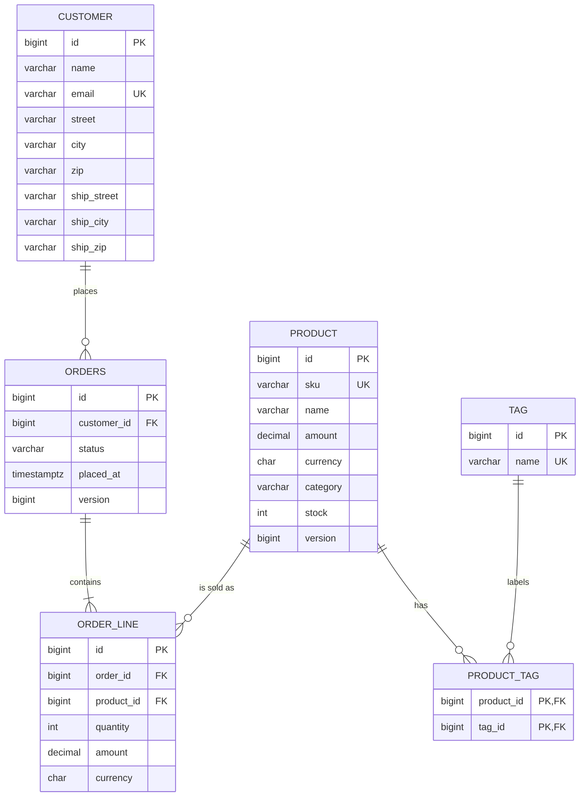

# shop-jpa — Lab 03

## 1. Entities and mappings, validated by Flyway

### Deliberate Schema Mismatches (`ddl-auto: validate`)

1. **Missing column (`sku` renamed to `code` in `V1__init.sql` only):**

```text
Caused by: org.hibernate.tool.schema.spi.SchemaManagementException: Schema validation: missing column [sku] in table [product]
	at org.hibernate.tool.schema.internal.AbstractSchemaValidator.validateTable(AbstractSchemaValidator.java:141) ~[hibernate-core-7.4.5.Final.jar:7.4.5.Final]
	at org.hibernate.tool.schema.internal.GroupedSchemaValidatorImpl.validateTables(GroupedSchemaValidatorImpl.java:42) ~[hibernate-core-7.4.5.Final.jar:7.4.5.Final]
	at org.hibernate.tool.schema.internal.AbstractSchemaValidator.performValidation(AbstractSchemaValidator.java:97) ~[hibernate-core-7.4.5.Final.jar:7.4.5.Final]
```

2. **Sequence increment mismatch (`product_seq` declared `INCREMENT BY 1` in `V1__init.sql` while `Product` specifies `allocationSize = 50`):**

```text
Caused by: org.hibernate.MappingException: The increment size of the [product_seq] sequence is set to [50] in the entity mapping but the mapped database sequence increment size is [1]
	at org.hibernate.id.enhanced.SequenceStyleGenerator.validatedIncrementSize(SequenceStyleGenerator.java:312) ~[hibernate-core-7.4.5.Final.jar:7.4.5.Final]
	at org.hibernate.id.enhanced.SequenceStyleGenerator.adjustIncrementSize(SequenceStyleGenerator.java:264) ~[hibernate-core-7.4.5.Final.jar:7.4.5.Final]
	at org.hibernate.id.enhanced.SequenceStyleGenerator.configure(SequenceStyleGenerator.java:208) ~[hibernate-core-7.4.5.Final.jar:7.4.5.Final]
```

## 2. Associations, cascading and entity identity

`OrderLine.order` is the owning side (`order_id` column). `Order.lines` is the inverse side with `mappedBy = "order"`, `cascade = ALL` and `orphanRemoval = true`. `addLine` / `removeLine` keep both sides in sync, and `getLines()` returns a read-only view.

### Persisting an order: 1 + N inserts, no update (`OrderCascadeTest`)

Only `em.persist(order)` is called; the two lines follow through cascade. `order_id` is already set by `addLine`, so no fix-up `UPDATE` is needed.

```text
DEBUG org.hibernate.SQL : insert into orders (customer_id,placed_at,status,version,id) values (?,?,?,?,?)
DEBUG org.hibernate.SQL : insert into order_line (order_id,product_id,quantity,amount,currency,id) values (?,?,?,?,?,?)
DEBUG org.hibernate.SQL : insert into order_line (order_id,product_id,quantity,amount,currency,id) values (?,?,?,?,?,?)
```

### Removing a line: orphan removal

`order.removeLine(order.getLines().get(0))` followed by `flush()`:

```text
DEBUG org.hibernate.SQL : delete from order_line where id=?
```

### Removing the order: cascade REMOVE

The remaining line is deleted before the order, so the foreign key is never violated:

```text
DEBUG org.hibernate.SQL : delete from order_line where id=?
DEBUG org.hibernate.SQL : delete from orders where id=? and version=?
```

### Entity identity (`EntityIdentityTest`)

`equals` compares the class and a non-null `id`; `hashCode` returns a constant per class. A new `Product` added to a `HashSet` before `persist` is still found after `flush` assigns its id, and a copy reloaded in a fresh persistence context is `equals` to the original but not `==`.

### The `toString` pitfall

`Order.toString()` was temporarily changed to print `lines`, and `OrderLine.toString()` to print `order`.

Printing an order loaded outside a transaction (detached, `lines` still a lazy proxy):

```text
org.hibernate.LazyInitializationException: Cannot lazily initialize collection of role 'edu.itc.shop.domain.Order.lines' with key '1' (no session)
```

Printing the same order inside a transaction (lines load, then each line prints its order, which prints its lines, ...):

```text
java.lang.StackOverflowError
```

Reverted: `toString` on every entity uses scalar fields only (`id`, `status`, `quantity`, ...), never associations.

## 3. Repositories, queries, projections and a paginated endpoint

### Boot-time derived query typo

Spring Data parses every repository method name while the application starts. A misspelled property fails the boot, before any request is served.

Method that was added to `OrderRepository`, then removed:

```java
List<Order> findByCustomerEmaliAndStatus(String email, OrderStatus status);
```

`./mvnw spring-boot:run` stopped with:

```text
org.springframework.beans.factory.UnsatisfiedDependencyException: Error creating bean with name 'orderService' ...
Error creating bean with name 'orderRepository' ...
No property 'emali' found for type 'Customer'; Did you mean 'email'; Traversed path: Order.customer

Caused by: org.springframework.data.repository.query.QueryCreationException:
Cannot create query for method [OrderRepository.findByCustomerEmaliAndStatus(java.lang.String,edu.itc.shop.domain.OrderStatus)];
No property 'emali' found for type 'Customer'; Did you mean 'email'; Traversed path: Order.customer

Caused by: org.springframework.data.core.PropertyReferenceException:
No property 'emali' found for type 'Customer'; Did you mean 'email'; Traversed path: Order.customer
```

`findByCustomerEmali…` walks `Order.customer` and then looks for `emali` on `Customer`. The property is `email`, so the repository bean is never created and the application does not start. The method was removed after this run. The correct query is `findByCustomerEmailAndStatusOrderByPlacedAtDesc`.

### `/api/orders` projection SQL

`GET /api/orders?status=PAID&page=0&size=2&sort=placedAt,desc` returns Spring Data's `page` envelope. The query selects only the columns the summary exposes:

```text
DEBUG org.hibernate.SQL : select o1_0.id,o1_0.status,o1_0.placed_at,c1_0.name
                          from orders o1_0
                          join customer c1_0 on c1_0.id=o1_0.customer_id
                          where o1_0.status=?
                          order by o1_0.placed_at desc
                          fetch first ? rows only
DEBUG org.hibernate.SQL : select count(o1_0.id) from orders o1_0 where o1_0.status=?
```

`findByStatus` uses `select new OrderSummaryRow(...)`, which implements the `OrderSummary` interface. A derived query for that interface selects every column of `customer`; the constructor query keeps the select list to `id`, `status`, `placed_at`, and `name`.

`Page<ProductView> findByCategory` is also a constructor query, because `amount` is `price.amount` on the embedded `Money`, not a field of `Product`.

The three HTTP transcripts, including the read-only transaction for `GET /api/customers/{email}/orders`, are in `api-session.md`.

## 4. Entity states, dirty checking, transactions and optimistic locking

Tests: `OrderServiceTest` (managed, detached, read-only), `FlushOrderTest` (flush order), and `OptimisticLockingTest` (optimistic locking and retry).

### Managed change: no `save()` needed

`OrderService.markPaid(id)` runs in `@Transactional`, loads the order and calls `setStatus(PAID)`. There is no `save()`. At commit, Hibernate compares the entity with the snapshot it took when loading it (dirty checking) and writes the change itself. The test clears `Statistics` before the call and asserts exactly one entity update and two statements:

```text
DEBUG org.hibernate.SQL : select o1_0.id,o1_0.customer_id,o1_0.placed_at,o1_0.status,o1_0.version from orders o1_0 where o1_0.id=?
DEBUG org.hibernate.SQL : update orders set customer_id=?,placed_at=?,status=?,version=? where id=? and version=?
```

### Detached change: nothing happens until `save()`, which is a merge

`products.findById(id)` runs in the repository's own short transaction. When it returns, the context is closed and the product is **detached**. `p.setStock(99)` then only changes a Java object, so a reload still shows the old stock. `products.save(p)` on an entity that already has an id is a **merge**: Hibernate first SELECTs the current row, copies the detached state onto it, then UPDATEs. The test asserts one load and one update:

```text
DEBUG org.hibernate.SQL : select p1_0.id,p1_0.category,p1_0.name,p1_0.amount,p1_0.currency,p1_0.sku,p1_0.stock from product p1_0 where p1_0.id=?
DEBUG org.hibernate.SQL : update product set category=?,name=?,amount=?,currency=?,sku=?,stock=? where id=?
```

### The read-only trap

Under `@Transactional(readOnly = true)`, Spring sets Hibernate's flush mode to `MANUAL` and loads entities read-only. A method that modifies an entity there does not fail: the change is silently dropped. `changeInsideReadOnlyTransactionIsNeverFlushed` calls a deliberately wrong test-only method (`ReadOnlyTrap.cancel`) and asserts zero updates and an unchanged status. Read-only is right for queries such as `OrderService.view(id)`, and wrong for anything that writes.

### Flush order: INSERT before DELETE

In one transaction, deleting the tag `sale` and saving a new tag `sale` fails at `flush()`, even though the delete was called first. Hibernate does not run statements in call order: at flush it executes all INSERTs, then UPDATEs, then DELETEs. So the new row hits the unique index while the old one still exists:

```text
DEBUG org.hibernate.SQL : insert into tag (name,id) values (?,?)
WARN  org.hibernate.orm.jdbc.error : Unique index or primary key violation: "PUBLIC.CONSTRAINT_143 INDEX PUBLIC.CONSTRAINT_INDEX_14 ON PUBLIC.TAG(NAME NULLS FIRST) VALUES ( /* 1 */ 'sale' )"
→ org.springframework.dao.DataIntegrityViolationException
```

Fix: call `tags.flush()` right after `delete`, so the DELETE reaches the database before the INSERT is queued:

```text
DEBUG org.hibernate.SQL : delete from tag where id=?
DEBUG org.hibernate.SQL : insert into tag (name,id) values (?,?)
```

Both variants are kept as tests: `insertRunsBeforeDeleteSoReusingTheUniqueNameFails` and `flushingTheDeleteFirstFixesIt`.

### Optimistic locking and retry (`OptimisticLockingTest`)

`Order.version` (`@Version`, `BIGINT NOT NULL DEFAULT 0` in `V1__init.sql`) makes Hibernate include `and version=?` in every `UPDATE`. When two threads load the same `Order` at `version = 0` (`CountDownLatch(2)` in `secondWriterFailsWithOptimisticLock`), the first commit increments `version` to `1`, and the second finds `0` matching rows and rolls back with `ObjectOptimisticLockingFailureException`.

`OrderFacade.changeStatusWithRetry` lives in a separate `@Service` bean outside `OrderService`, because Spring's `@Transactional` proxy commits and throws `ObjectOptimisticLockingFailureException` when `OrderService.changeStatus` returns. Retrying up to 3 times lets both concurrent writers succeed and ends at `version = versionBefore + 2`.

Excerpt from `OptimisticLockingTest` (`org.springframework.orm.jpa=DEBUG`, `org.springframework.transaction.interceptor=TRACE` in `application-test.yml`):

```text
TRACE o.s.t.i.TransactionInterceptor : Getting transaction for [edu.itc.shop.service.OrderService.changeStatus]
DEBUG org.hibernate.SQL              : select o1_0.id,o1_0.customer_id,o1_0.placed_at,o1_0.status,o1_0.version from orders o1_0 where o1_0.id=?
DEBUG org.hibernate.SQL              : update orders set customer_id=?,placed_at=?,status=?,version=? where id=? and version=?
DEBUG o.s.orm.jpa.JpaTransactionManager : Initiating transaction rollback after commit exception
org.springframework.orm.ObjectOptimisticLockingFailureException: Batch update returned unexpected row count from update 0 (expected row count 1 but was 0) [update orders set customer_id=?,placed_at=?,status=?,version=? where id=? and version=?] for entity [edu.itc.shop.domain.Order with id '2']
DEBUG o.s.orm.jpa.JpaTransactionManager : Rolling back JPA transaction on EntityManager [SessionImpl(1169592289<open>)]
TRACE o.s.t.i.TransactionInterceptor : Getting transaction for [edu.itc.shop.service.OrderService.changeStatus]
DEBUG org.hibernate.SQL              : update orders set customer_id=?,placed_at=?,status=?,version=? where id=? and version=?
```

## 5. N+1, performance tuning and a second migration

<!-- Task 5 -->

Tests: `NPlusOneTest`, `ProductNameReportTest`, `BatchInsertTest`, `OpenInViewTest`, `FlywayMigrationTest`, and `ReportTimingTest` (tagged `perf`). Statements are counted with `QueryCounter` (`Statistics.getPrepareStatementCount()`). The seed data is 50 PAID orders × 3 lines over 30 products.

### Deviation from the handout: where `@BatchSize` lives

In Hibernate 7 a `@BatchSize` on a collection overrides every other setting (`LoadQueryInfluencers.effectiveBatchSize`). With `@BatchSize(16)` on `Order.lines`, the "naive" loop would also run 5 statements, and the 51-statement demo could never pass. Fix C is therefore on a second, read-only mapping of the same rows:

```java
@OneToMany(mappedBy = "order")
@BatchSize(size = 16)
private List<OrderLine> batchedLines;
```

For the same reason `default_batch_fetch_size=32` is not set globally. Only `ProductNameReportTest.WithDefaultBatchFetchSize32` switches it on.

### Lines per PAID order: statements and median time

Median of 20 runs after 20 warm-up runs, SQL logging off, in-memory H2:

| variant                 | statements | median ms |
|-------------------------|-----------:|----------:|
| naive (lazy loop)       |         51 |       4.2 |
| join fetch              |          1 |       1.6 |
| @EntityGraph            |          1 |       3.1 |
| @BatchSize(16)          |          5 |       1.9 |

The times are small because H2 runs in the same JVM with no network round trip. On a real database every extra statement costs a round trip, so the gap between 51 and 1 grows a lot.

### Adding `line.getProduct().getName()`

| variant           | without global batch size | with `default_batch_fetch_size=32` |
|-------------------|--------------------------:|-----------------------------------:|
| naive             |       81 (1 + 50 + 30)    |                  4 (1 + 2 + 1)     |
| join fetch        |       31 (1 + 30)         |                  2 (1 + 1)         |
| @EntityGraph      |        1                  |                  1                 |
| @BatchSize(16)    |       35 (5 + 30)         |                  6 (5 + 1)         |

Join fetch and `@BatchSize` regress into N+1 on `product` (one SELECT per distinct product). Only the entity graph, which also fetches `lines.product`, stays at 1. `default_batch_fetch_size=32` caps every lazy association at `ceil(n / 32)` extra statements. The explicit `@BatchSize(16)` on `batchedLines` still wins over the global 32.

### JDBC batching

`hibernate.jdbc.batch_size=50`, `order_inserts=true`, `order_updates=true`. `BatchInsertTest` saves 1 000 products with `saveAll` in one transaction:

```text
BatchInsertTest: inserts=1000, prepared statements=22
TRACE org.hibernate.orm.jdbc.batch : Executing JDBC batch (50 / 50) - [edu.itc.shop.domain.Product#INSERT]
... (20 batches)
```

In Hibernate 7 the logger is `org.hibernate.orm.jdbc.batch`; the handout's `org.hibernate.engine.jdbc.batch` is the Hibernate 6 name.

**IDENTITY experiment** (scratch copy, not committed): `Product` switched to `GenerationType.IDENTITY` and `id BIGINT GENERATED BY DEFAULT AS IDENTITY`:

```text
BatchInsertTest: inserts=1000, prepared statements=1000
```

No "Executing JDBC batch" lines at all. With IDENTITY, Hibernate needs the database to generate each id at insert time, so every row is its own INSERT and batching is disabled. A sequence with `allocationSize = 50` lets Hibernate hand out ids in memory and send the INSERTs in batches.

### `open-in-view=false`

`GET /api/orders/{id}/lines-broken` loads the order with `findById` and touches `getLines()` in the controller, after the repository transaction has closed:

```text
$ curl -s -o /dev/null -w "%{http_code}" localhost:8080/api/orders/1/lines-broken
500
ERROR ... Request processing failed: org.hibernate.LazyInitializationException: Cannot lazily initialize collection of role 'edu.itc.shop.domain.Order.lines' ...
```

`OpenInViewTest` asserts the same `LazyInitializationException` by calling the controller method. The fix is `GET /api/orders/{id}/lines`, which delegates to `OrderService.findLines`, so the mapping runs inside `@Transactional(readOnly = true)`.

### `V2__indexes.sql`

```text
INFO o.f.core.internal.command.DbValidate : Successfully validated 2 migrations
INFO o.f.core.internal.command.DbMigrate  : Migrating schema "PUBLIC" to version "1 - init"
INFO o.f.core.internal.command.DbMigrate  : Migrating schema "PUBLIC" to version "2 - indexes"
INFO o.f.core.internal.command.DbMigrate  : Successfully applied 2 migrations to schema "PUBLIC", now at version v2
```

The database is in-memory, so each start applies both migrations. `flyway_schema_history` holds the two migrations, plus the row Flyway 11 adds when it creates the table (`FlywayMigrationTest`):

```text
installed_rank=-1  version=null  << Flyway Schema History table created >>
installed_rank=1   version=1     init
installed_rank=2   version=2     indexes
```

**EXPLAIN of the `/api/orders` query, before (V1 only):**

```text
FROM "PUBLIC"."ORDERS" "O1_0"
    /* PUBLIC.ORDERS.tableScan */
    /* WHERE O1_0.STATUS = 'PAID' */
INNER JOIN "PUBLIC"."CUSTOMER" "C1_0"
    /* PUBLIC.PRIMARY_KEY_5: ID = O1_0.CUSTOMER_ID */
ORDER BY 3 DESC
FETCH FIRST 2 ROWS ONLY
```

**After (V1 + V2):**

```text
FROM "PUBLIC"."ORDERS" "O1_0"
    /* PUBLIC.ORDERS.tableScan */
    /* WHERE O1_0.STATUS = 'PAID' */
INNER JOIN "PUBLIC"."CUSTOMER" "C1_0"
    /* PUBLIC.PRIMARY_KEY_5: ID = O1_0.CUSTOMER_ID */
ORDER BY 3 DESC
FETCH FIRST 2 ROWS ONLY
```

The plan does not change: `/api/orders` filters on `status` and sorts on `placed_at`, and none of the three V2 indexes starts with `status`. An index on `orders (status, placed_at DESC)` would serve it. The new indexes do help the customer queries, for example `WHERE customer_id = ? ORDER BY placed_at DESC`:

```text
before: /* PUBLIC.FK_ORDERS_CUSTOMER_INDEX_8: CUSTOMER_ID = CAST(1 AS BIGINT) */   then sorts on placed_at
after:  /* PUBLIC.IDX_ORDERS_CUSTOMER_PLACED: CUSTOMER_ID = CAST(1 AS BIGINT) */   index already in placed_at order
```

## 6. Challenge: reporting and bulk module

<!-- Challenge -->

| Requirement | Code | Tests |
|---|---|---|
| 1. Criteria report | `ProductReportRepository` + `ProductReportRepositoryImpl`, `ReportController` | `ProductReportTest` |
| 2. Infinite scroll | `OrderFeedService`, `OrderFeedController`, `OrderRepository.feedSlice / findAllByOrderByPlacedAtDescIdDesc / feedAfter` | `OrderFeedTest`, `FeedPerformanceTest` (`perf`) |
| 3. Stock reservation | `StockService`, `ProductRepository.findForUpdate / decrementStock`, `@Version` on `Product` | `StockReservationTest` |
| 4. Bulk import | `BulkImportService` | `BulkImportTest` |

`V3__challenge.sql` adds `product.version`, the index `idx_orders_placed_id (placed_at DESC, id DESC)` and changes `product_seq` to `INCREMENT BY 500` (see requirement 4). The static metamodel (`Product_`, `Money_`, `Tag_`, ...) is generated by `hibernate-processor`, configured in `pom.xml`.

Every timing below is from one `./mvnw test` run on in-memory H2 (same JVM, no network). SQL and transaction logging are muted during measurements by the `QuietSql` test helper: log levels are global to the JVM, and an earlier attempt that only used `@SpringBootTest(properties = "logging.level...=OFF")` measured the console instead (the bulk import took 31 s with 166 110 INSERT lines logged).

### 1. Criteria API report

`GET /api/reports/products?q=&category=&maxPrice=&minStock=&tag=&sort=`, all parameters optional. Each filter adds a predicate only when it is present, the join to `tags` is added only when `tag` is given, and `sort` must be one of `sku`, `name`, `amount`, `stock`, `tagCount` (optionally `,asc` / `,desc`), otherwise HTTP 400.

```text
$ curl -s "localhost:8080/api/reports/products?category=HARDWARE&minStock=1&tag=keyboard&sort=amount,desc"
[{"sku":"KB-9","name":"Keyboard Workstation","amount":140.00,"stock":3,"tagCount":2},
 {"sku":"KB-7","name":"Tenkeyless Keyboard","amount":59.00,"stock":7,"tagCount":2},
 {"sku":"KB-1","name":"Compact Keyboard","amount":25.00,"stock":12,"tagCount":2}]

$ curl -s -o /dev/null -w "%{http_code}" "localhost:8080/api/reports/products?sort=id"
400
```

`tagCount` uses `cb.size(p.get(Product_.tags))`, a correlated subquery, so it counts all tags of a product even when the `tag` filter has joined to just one of them. `groupBy` keeps one row per product.

```sql
-- without tag
select p1_0.sku c0,p1_0.name c1,p1_0.amount c2,p1_0.stock c3,
       (select count(*) from product_tag t1_0 where p1_0.id=t1_0.product_id) c4
from product p1_0
where lower(p1_0.name) like ? escape '' and p1_0.category=? and p1_0.amount<=? and p1_0.stock>=?
group by p1_0.id,c0,c1,c2,c3 order by 3 desc,1

-- with tag: the join appears
select p1_0.sku c0,p1_0.name c1,p1_0.amount c2,p1_0.stock c3,
       (select count(*) from product_tag t2_0 where p1_0.id=t2_0.product_id) c4
from product p1_0 join product_tag t1_0 on p1_0.id=t1_0.product_id join tag t1_1 on t1_1.id=t1_0.tag_id
where p1_0.category=? and p1_0.stock>=? and t1_1.name=?
group by p1_0.id,c0,c1,c2,c3 order by 3 desc,1
```

### 2. Infinite scroll

`GET /api/orders/feed?size=20&after=<placedAt>,<id>` (keyset, `Window<Order>`) and `GET /api/orders/feed/slice?size=20&after=<page>` (offset, `Slice<OrderSummary>`) return the same envelope:

```text
$ curl -s "localhost:8080/api/orders/feed?size=20"
{"items":[{"id":30,"status":"PAID","placedAt":"2026-09-02T05:00:00Z","customer":{"name":"Alan Turing"}}, ...],
 "nextCursor":"2026-09-01T10:00:00Z,11","hasNext":true}

$ curl -s "localhost:8080/api/orders/feed?size=20&after=2026-09-01T10:00:00Z,11"
{"items":[{"id":10, ...}, ... 10 items],"nextCursor":null,"hasNext":false}
```

The SQL (each reads `size + 1` rows to know `hasNext`; a `Slice` never runs a count query):

```sql
-- Slice: page n skips n * size rows
select o1_0.id,o1_0.status,o1_0.placed_at,c1_0.name from orders o1_0
left join customer c1_0 on c1_0.id=o1_0.customer_id
order by o1_0.placed_at desc,o1_0.id desc offset ? rows fetch first ? rows only

-- Window, first page: ScrollPosition.keyset()
select o1_0.id,o1_0.customer_id,o1_0.placed_at,o1_0.status,o1_0.version from orders o1_0
order by o1_0.placed_at desc,o1_0.id desc fetch first ? rows only

-- Window, next page: ScrollPosition.forward({placedAt, id})
select o1_0.id,o1_0.customer_id,o1_0.placed_at,o1_0.status,o1_0.version from orders o1_0
where o1_0.placed_at<? or o1_0.placed_at=? and o1_0.id<?
order by o1_0.placed_at desc,o1_0.id desc fetch first ? rows only
-- + the customers of the page in one query (@BatchSize(20) on Customer)
select c1_0.id,...,c1_0.name,... from customer c1_0 where c1_0.id in (?,?,?,?,?,?,?,?,?,?,?,?,?,?,?,?,?,?,?,?)
```

**Measured with 200 400 orders** (`FeedPerformanceTest`, median of 15 calls, each for a different page):

| variant                     | offset 20-400 | offset 100 000 |
|-----------------------------|--------------:|---------------:|
| Slice (OFFSET)              |       0.32 ms |       28.07 ms |
| Window keyset (Spring Data) |       0.94 ms |       11.52 ms |
| row-value keyset (seek)     |       0.27 ms |        0.24 ms |

`EXPLAIN ANALYZE` at offset 100 000 shows why (`scanCount` = index entries read):

```text
slice : ORDERS /* IDX_ORDERS_PLACED_ID */ /* scanCount: 100021 */ ... OFFSET 100000 ROWS FETCH NEXT 21 ROWS ONLY
window: ORDERS /* IDX_ORDERS_PLACED_ID */ /* scanCount: 100021 */ WHERE PLACED_AT < ? OR (PLACED_AT = ? AND ID < ?)
seek  : ORDERS /* IDX_ORDERS_PLACED_ID: PLACED_AT <= ? */ /* scanCount: 22 */ WHERE ROW (PLACED_AT, ID) < ROW (?, ?)
```

**Why keyset stays fast:** `OFFSET 100000` cannot jump; the database walks 100 000 index entries just to throw them away, so the cost grows with the page number. A keyset query asks "the 21 rows just below this `(placed_at, id)`", and with an index on exactly those columns the database seeks to that point and reads 21 entries, the same work on page 1 or page 5 000. Ties on `placed_at` are broken by `id`, so no row is skipped or repeated (`OrderFeedTest` walks the whole feed both ways and compares).

What H2 taught us on the way:

- **Spring Data's keyset SQL is not seekable on H2.** It expands the cursor into `placed_at < ? or (placed_at = ? and id < ?)`. H2 still uses the index for the ordering, but walks it from the top: 100 021 entries at offset 100 000. The same condition written as a row value, `(placed_at, id) < (?, ?)`, turns into an index range: 22 entries. That is `OrderRepository.feedAfter` (HQL tuple comparison), available as `OrderFeedService.seek`. The endpoint keeps the `Window` version that the handout asks for. On PostgreSQL the OR form is usually planned as a range too.
- **Join direction matters.** With `join o.customer c` H2 starts from the 3-row `customer` table and then has to sort every order: about 30 ms on every page, even page 1. `left join` (a customer is never null) makes H2 read `orders` first, in index order, and stop after 21 rows. For the `Window`, `@EntityGraph(attributePaths = "customer")` produced the same inner join (70-85 ms); it was replaced by `@BatchSize(size = 20)` on `Customer`, which loads the customers of a page in one extra query.
- **H2 reuses the result of an identical query** on unchanged tables. A first benchmark that repeated the same page measured 0.6 ms for `OFFSET 100000`; every timed call now asks for a different page.

### 3. Stock reservation that never oversells

10 threads each reserve 1 unit of a product with `stock = 5` (`StockReservationTest`):

```text
pessimistic: 5 ok / 5 out-of-stock, stock=0, 10 threads in 23 ms
optimistic : 5 ok / 5 out-of-stock, stock=0, after 13 retries, 5 ms
atomic upd : 5 ok / 5 out-of-stock, stock=0, 18 ms
```

| variant | how | SQL per call |
|---|---|---|
| pessimistic | `@Lock(PESSIMISTIC_WRITE)` on `findForUpdate`, check, decrement | `select ... from product p1_0 where p1_0.id=? for update` + `update product set ...,stock=?,version=? where id=? and version=?` |
| optimistic | `@Version` on `Product`; plain `findById`, check, decrement; on `ObjectOptimisticLockingFailureException` retry in a new transaction (max 50, random back-off) | `select ... where p1_0.id=?` + `update product set ...,stock=?,version=? where id=? and version=?` (0 rows = someone else won) |
| atomic | `@Modifying` JPQL, the `WHERE` is the stock check; 0 rows = out of stock | `update product p1_0 set stock=(p1_0.stock-cast(? as integer)) where p1_0.id=? and p1_0.stock>=?` |

**Throughput**, 10 threads × 100 calls against `stock = 500` (500 succeed, 500 out of stock):

| variant     | 1 000 calls | calls/s | notes |
|-------------|------------:|--------:|-------|
| pessimistic |      678 ms |   1 475 | callers queue on the row lock |
| optimistic  |      433 ms |   2 309 | 712 retries |
| atomic      |      161 ms |   6 211 | one statement, no read |

The single-statement update is the fastest and the simplest: no read, no lock held across a round trip, no retry. It bypasses `@Version` (a JPQL bulk update does not increment it), which is fine here because nothing else holds a stale copy of `stock` for long. Optimistic locking does well on H2 because conflicts are detected cheaply in memory, but under a hot row it **starves**: in earlier runs with a limit of 20 attempts and no back-off, 1-2 of the 1 000 calls lost 20 times in a row and gave up (`gave up` is counted separately by the test). The back-off and a limit of 50 fixed it in these runs, but there is no guarantee. Pessimistic locking never retries and never starves, at the cost of serialising every caller.

### 4. Bulk import of 50 000 products

`BulkImportTest` generates a CSV (`sku;name;amount;currency;category;stock`), imports it three ways after a 5 000-row warm-up of each variant, and deletes it again:

| run | wall time | JDBC statements | peak heap |
|---|---:|---:|---:|
| `StatelessSession.insertMultiple`, chunks of 500, `setJdbcBatchSize(500)` | 0.6 s | 301 | +125 MB |
| `saveAll`, one `@Transactional`, no clear | 1.0 s | 102 | +431 MB |
| `saveAll` + `flush()`/`clear()` every 500 | 0.6 s | 201 | +207 MB |

Statements = 100 `select next value for product_seq` + 100 batches of 500 for the stateless run (`insert into product (category,name,amount,currency,sku,stock,version,id) values (?,?,?,?,?,?,?,?)`) + 1 count; the stateful runs reuse one prepared INSERT per flush. Peak heap is sampled every 2 ms with `MemoryMXBean`, so it is approximate and includes garbage not yet collected. The run without `clear()` keeps all 50 000 `Product` objects (and their snapshots for dirty checking) in the persistence context until commit; that is the run to avoid as the file grows.

**`product_seq` changed to `INCREMENT BY 500`.** With the original `INCREMENT BY 50`, the stateless run sent 1 100 batches of about 50 rows and 2 101 statements: Hibernate has to execute the pending batch before every `select next value for product_seq`, which a `StatelessSession` asks for while inserting. A stateful session draws all ids at `persist` time, before the flush, so it was not affected. `allocationSize` on `Product` is 500 to match, so section 5's `BatchInsertTest` now needs 2 sequence calls instead of 20.

### 5. Schema



Indexes besides primary and unique keys: `idx_orders_customer_placed (customer_id, placed_at DESC)`, `idx_order_line_order (order_id)`, `idx_product_category_amount (category, amount)` (V2) and `idx_orders_placed_id (placed_at DESC, id DESC)` (V3).

### Every repository method and its SQL

Copied from the `org.hibernate.SQL` log, parameters as `?`. `CustomerRepository` and `TagRepository` declare no methods of their own; the inherited `JpaRepository` methods look like the `findById` / `save` rows at the end.

| method | SQL |
|---|---|
| `ProductRepository.existsBySku` | `select p1_0.id from product p1_0 where p1_0.sku=? fetch first ? rows only` |
| `ProductRepository.findTop3ByCategoryOrderByPriceAmountDesc` | `select p1_0.id,p1_0.category,p1_0.name,p1_0.amount,p1_0.currency,p1_0.sku,p1_0.stock,p1_0.version from product p1_0 where p1_0.category=? order by p1_0.amount desc fetch first ? rows only` |
| `ProductRepository.findByTagsName` | `select p1_0.id,p1_0.category,p1_0.name,p1_0.amount,p1_0.currency,p1_0.sku,p1_0.stock,p1_0.version from product p1_0 left join product_tag t1_0 on p1_0.id=t1_0.product_id left join tag t1_1 on t1_1.id=t1_0.tag_id where t1_1.name=?` |
| `ProductRepository.findByCategory` (Page) | `select p1_0.id,p1_0.sku,p1_0.name,p1_0.amount,p1_0.stock from product p1_0 where p1_0.category=? order by p1_0.sku offset ? rows fetch first ? rows only`<br>`select count(*) from product p1_0 where p1_0.category=?` |
| `ProductRepository.findLowStock` (native) | `SELECT p.* FROM product p WHERE p.stock < ? ORDER BY p.stock` |
| `ProductRepository.findAll(Specification, Pageable)` (`ProductSpecs.filter`) | `select p1_0.id,p1_0.category,p1_0.name,p1_0.amount,p1_0.currency,p1_0.sku,p1_0.stock,p1_0.version from product p1_0 where lower(p1_0.name) like ? escape '' and p1_0.category=? and p1_0.amount<=? and p1_0.stock>? offset ? rows fetch first ? rows only`<br>`select count(p1_0.id) from product p1_0 where lower(p1_0.name) like ? escape '' and p1_0.category=? and p1_0.amount<=? and p1_0.stock>?` |
| `ProductRepository.report` (Criteria, no tag) | `select p1_0.sku c0,p1_0.name c1,p1_0.amount c2,p1_0.stock c3,(select count(*) from product_tag t1_0 where p1_0.id=t1_0.product_id) c4 from product p1_0 where lower(p1_0.name) like ? escape '' and p1_0.category=? and p1_0.amount<=? and p1_0.stock>=? group by p1_0.id,c0,c1,c2,c3 order by 3 desc,1` |
| `ProductRepository.report` (Criteria, tag) | `select p1_0.sku c0,p1_0.name c1,p1_0.amount c2,p1_0.stock c3,(select count(*) from product_tag t2_0 where p1_0.id=t2_0.product_id) c4 from product p1_0 join product_tag t1_0 on p1_0.id=t1_0.product_id join tag t1_1 on t1_1.id=t1_0.tag_id where p1_0.category=? and p1_0.stock>=? and t1_1.name=? group by p1_0.id,c0,c1,c2,c3 order by 3 desc,1` |
| `ProductRepository.findForUpdate` | `select p1_0.id,p1_0.category,p1_0.name,p1_0.amount,p1_0.currency,p1_0.sku,p1_0.stock,p1_0.version from product p1_0 where p1_0.id=? for update` |
| `ProductRepository.decrementStock` | `update product p1_0 set stock=(p1_0.stock-cast(? as integer)) where p1_0.id=? and p1_0.stock>=?` |
| `OrderRepository.findByCustomerEmailAndStatusOrderByPlacedAtDesc` | `select o1_0.id,o1_0.customer_id,o1_0.placed_at,o1_0.status,o1_0.version from orders o1_0 join customer c1_0 on c1_0.id=o1_0.customer_id where c1_0.email=? and o1_0.status=? order by o1_0.placed_at desc` |
| `OrderRepository.countByStatus` | `select count(o1_0.id) from orders o1_0 where o1_0.status=?` |
| `OrderRepository.findFirstByCustomerIdOrderByPlacedAtDesc` | `select o1_0.id,o1_0.customer_id,o1_0.placed_at,o1_0.status,o1_0.version from orders o1_0 where o1_0.customer_id=? order by o1_0.placed_at desc fetch first ? rows only` |
| `OrderRepository.findByStatus(status, Pageable)` | `select o1_0.id,o1_0.status,o1_0.placed_at,c1_0.name from orders o1_0 join customer c1_0 on c1_0.id=o1_0.customer_id where o1_0.status=? order by o1_0.placed_at desc offset ? rows fetch first ? rows only`<br>`select count(*) from orders o1_0 where o1_0.status=?` |
| `OrderRepository.findWithLinesByCustomerEmail` | `select distinct o1_0.id,o1_0.customer_id,l1_0.order_id,l1_0.id,l1_0.product_id,p1_0.id,p1_0.category,p1_0.name,p1_0.amount,p1_0.currency,p1_0.sku,p1_0.stock,p1_0.version,l1_0.quantity,l1_0.amount,l1_0.currency,o1_0.placed_at,o1_0.status,o1_0.version from orders o1_0 join order_line l1_0 on o1_0.id=l1_0.order_id join product p1_0 on p1_0.id=l1_0.product_id join customer c1_0 on c1_0.id=o1_0.customer_id where c1_0.email=? order by o1_0.placed_at desc` |
| `OrderRepository.countLinesByStatus` | `select count(ol1_0.id) from order_line ol1_0 join orders o1_0 on o1_0.id=ol1_0.order_id where o1_0.status=?` |
| `OrderRepository.findByStatus(status)` | `select o1_0.id,o1_0.customer_id,o1_0.placed_at,o1_0.status,o1_0.version from orders o1_0 where o1_0.status=?` |
| `OrderRepository.findByStatusWithLines` | `select distinct o1_0.id,o1_0.customer_id,l1_0.order_id,l1_0.id,l1_0.product_id,l1_0.quantity,l1_0.amount,l1_0.currency,o1_0.placed_at,o1_0.status,o1_0.version from orders o1_0 join order_line l1_0 on o1_0.id=l1_0.order_id where o1_0.status=?` |
| `OrderRepository.findWithGraphByStatus` | `select o1_0.id,o1_0.customer_id,l1_0.order_id,l1_0.id,l1_0.product_id,p1_0.id,p1_0.category,p1_0.name,p1_0.amount,p1_0.currency,p1_0.sku,p1_0.stock,p1_0.version,l1_0.quantity,l1_0.amount,l1_0.currency,o1_0.placed_at,o1_0.status,o1_0.version from orders o1_0 left join order_line l1_0 on o1_0.id=l1_0.order_id left join product p1_0 on p1_0.id=l1_0.product_id where o1_0.status=?` |
| `OrderRepository.feedSlice` | `select o1_0.id,o1_0.status,o1_0.placed_at,c1_0.name from orders o1_0 left join customer c1_0 on c1_0.id=o1_0.customer_id order by o1_0.placed_at desc,o1_0.id desc offset ? rows fetch first ? rows only` |
| `OrderRepository.findAllByOrderByPlacedAtDescIdDesc` (first window) | `select o1_0.id,o1_0.customer_id,o1_0.placed_at,o1_0.status,o1_0.version from orders o1_0 order by o1_0.placed_at desc,o1_0.id desc fetch first ? rows only` |
| `OrderRepository.findAllByOrderByPlacedAtDescIdDesc` (next window) | `select o1_0.id,o1_0.customer_id,o1_0.placed_at,o1_0.status,o1_0.version from orders o1_0 where o1_0.placed_at<? or o1_0.placed_at=? and o1_0.id<? order by o1_0.placed_at desc,o1_0.id desc fetch first ? rows only` |
| `OrderRepository.feedAfter` | `select o1_0.id,o1_0.status,o1_0.placed_at,c1_0.name from orders o1_0 left join customer c1_0 on c1_0.id=o1_0.customer_id where (o1_0.placed_at,o1_0.id)<(?,?) order by o1_0.placed_at desc,o1_0.id desc fetch first ? rows only` |
| `JpaRepository.findById` (Order) | `select o1_0.id,o1_0.customer_id,o1_0.placed_at,o1_0.status,o1_0.version from orders o1_0 where o1_0.id=?` |
| `CustomerRepository.findById` | `select c1_0.id,c1_0.street,c1_0.city,c1_0.zip,c1_0.email,c1_0.name,c1_0.ship_street,c1_0.ship_city,c1_0.ship_zip from customer c1_0 where c1_0.id=?` |
| `TagRepository.save` (new tag) | `select next value for tag_seq` (once per 50 ids)<br>`insert into tag (name,id) values (?,?)` |
